# Coupled grid + traffic + fleet simulation: where should the 5th depot go?

GIRS Project #4. This folder couples the grid layer (`../grid`) and the traffic layer (`../traffic/v3_time_of_day`),
adds the remaining Failure Mode Table rows, and runs two experiments:

1. **Placement.** Waymo already has depots at **Santa Monica (1), Sawtelle (2), LAX (4), Culver City (5)**.
   Which of the other six nodes is the best place for one more depot?
2. **Second fleet.** Tesla adds its own fleet (1/3, 2/3 or 1x Waymo's size). Should the depots be **universal**
   (every company charges anywhere) or **exclusive** (Tesla gets its own new depot, Waymo keeps its four)?
   Where should the new depot go in each case?

Tags follow the rest of the repo: **[DOC]** Failure Mode Table / notes · **[DATA]** computed from a public
dataset · **[SRC]** an outside source listed under *Sources* · **[USER]** task spec · **[ASSUMPTION]** · **GAP**.
Every number in the code carries one of these in `config.py` or `scenarios.py`.

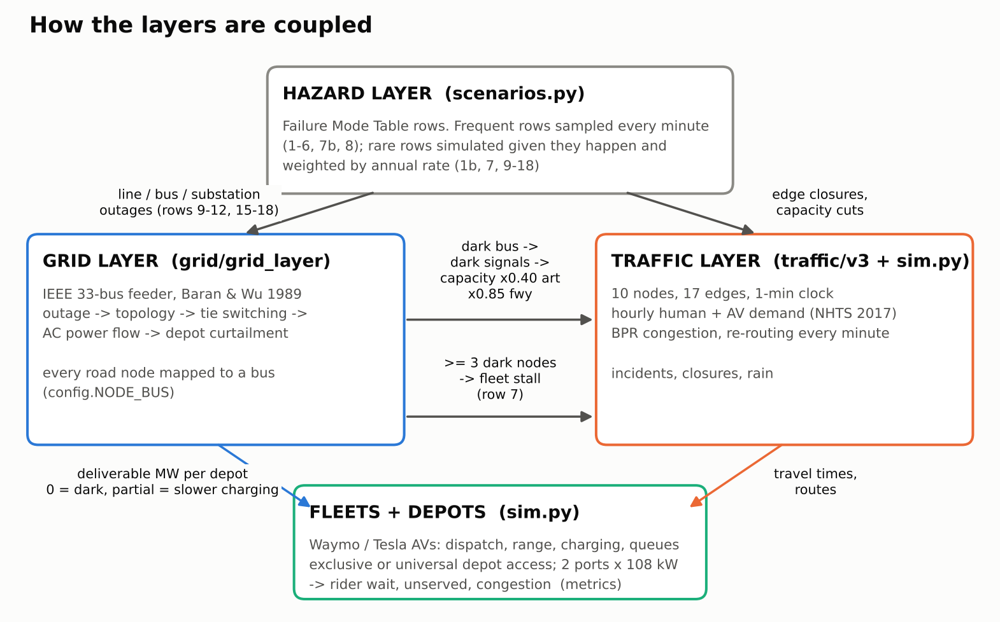

---

## Quick start

```bash
pip install -r ../requirements.txt
cd ..                                            # repo root
export PYTHONPATH=.
python -m coupled.check_av_demand                # is AV demand a scaled-down ride-hail stream?
python -m coupled.calibrate_row8                 # row 8 probability (already set in config.py)
python -m coupled.experiments all                # ~3,000 simulated days, ~15 min on 2 cores
python -m coupled.experiments placement_more     # +2,340 days: more seeds for the placement ranking
python -m coupled.experiments compare35          # the same runs at 3.5 mi/kWh, for section 5.5
python -m coupled.report                         # tables -> results/, figures -> figures/
```

| File | What it is |
|---|---|
| `config.py` | Every assumption: depots, node <-> bus table, hazard zones, dark-signal factors, new failure-mode parameters, fleets |
| `scenarios.py` | Hazard layer: Failure Mode Table rows -> the events of one simulated day, with annual rates |
| `sim.py` | `CoupledSim`: traffic v3 + grid layer + several fleets + the new failure modes |
| `experiments.py` | Placement, multi-fleet and showcase runs (common random numbers, 2 worker processes) |
| `report.py` | Annual weighting, paired differences, figures, `results/summary.md` |
| `check_av_demand.py`, `calibrate_row8.py` | The AV demand check and the row-8 calibration |
| `results/` | One row per simulated day (`*_runs.csv`) and the summaries |
| `figures/` | Everything below, at 180 dpi for slides |

---

## 1. How the layers are coupled

### Depot <-> bus table

Every road node gets a feeder bus. The bus powers that node's depot (if built) **and** its traffic signals.
The IEEE 33-bus feeder has no geography, so the mapping is an **[ASSUMPTION]** chosen to put each node on the
placeholder hazard zone that matches its real exposure:

| Node | Bus | Feeder position | Hazard zone |
|---|---|---|---|
| 1 Santa Monica (existing) | 21 | upper lateral, strong | WUI (Palisades / Santa Monica Mtns edge) |
| 2 Sawtelle (existing) | 3 | trunk | — |
| 3 West Hollywood | 7 | main feeder, mid | — |
| 4 LAX (existing) | 26 | lower lateral | — |
| 5 Culver City (existing) | 22 | lateral 2 | 500-yr floodplain (Ballona Creek) |
| 6 Downtown LA | 2 | trunk, next to the substation | — |
| 7 Playa del Rey | 23 | lateral 2 | 100-yr floodplain (Ballona wetlands) |
| 8 Mid-City | 10 | main feeder, weak | — |
| 9 Hollywood | 29 | far lower lateral | WUI (Hollywood Hills) |
| 10 Pasadena | 32 | end of lower lateral, weakest | WUI (San Gabriel foothills) |

The WUI zone holds exactly three nodes, which matches row 12's "PSPS, >= 3 nodes" definition.

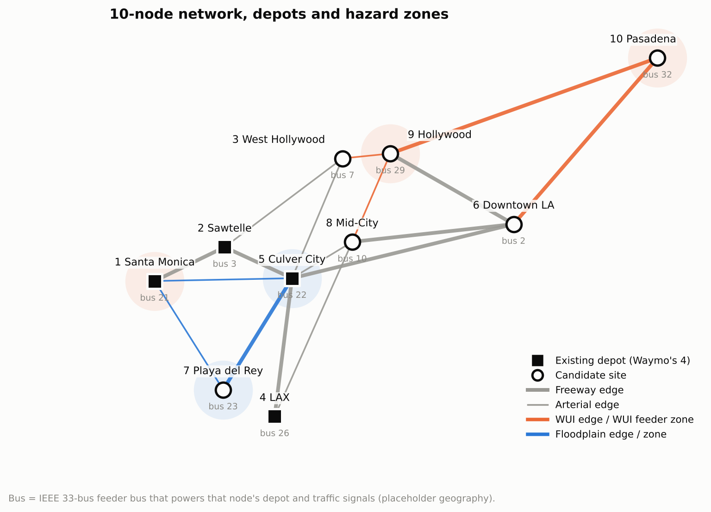

### Grid -> depots: partial capacity

Every simulated minute the grid layer takes the active outages, runs topology -> tie switching -> AC power flow ->
curtailment, and returns each built depot's **deliverable MW** (each depot asks for its rated
2 ports x 108 kW = 0.216 MW [DOC: 1.8 kWh/min]).

- **0 MW**: the depot is dark. Charging sessions stop, queued AVs leave, AVs route to another depot.
- **Between 0 and rated**: partial capacity. The available power is split among the AVs plugged in, so each
  session runs slower (`depot_rate()` in `sim.py`). Depot choice accounts for this: an AV picks the depot with the
  lowest drive time + expected queue + extra charging time.
- This is **one-way** coupling (the grid sets each depot's available capacity at rated demand). Two-way coupling
  (fleet demand changing the feeder's voltage) only matters when several depots on one weak feeder draw at once;
  it is the next step if depots get larger (see the N-1 study, fig 10).

### Grid -> traffic: dark signals become congestion automatically

When a node's bus is dark **after switching**, its traffic signals are dark. A dark signal is legally an all-way
stop [SRC: Toronto, ODOT and Jefferson County guidance]. Every edge touching that node gets a capacity factor:

| Edge class | Factor | Basis |
|---|---|---|
| Arterial | x 0.40 | Signalized lane ~1,900 veh/h of green x g/C 0.45 ~ 850 veh/h/lane [SRC: HCM via NCHRP]; an all-way stop moves 400-1,400 veh/h for the **whole intersection** [SRC: Al-Kaisy & Doruk 2023]. For two 2-lane arterials that is ~0.2-0.3; 0.40 allows for officers and turn bays [ASSUMPTION within the range] |
| Freeway | x 0.85 | Mainline is unaffected; the model's freeway edges include surface access (v3 README) [ASSUMPTION] |
| Battery backup | first 6 h: half the loss | About half of Austin's signals have batteries lasting up to 6 h [SRC: Austin Monitor 2023]. No LA figure found (GAP) |

The factor multiplies the edge's BPR capacity, so the extra delay comes out of the existing congestion model with
no separate rule. Switching it off (`signals=False`) gives the uncoupled comparison in fig 5.

### Grid -> fleet: row 7 triggered by dark signals

In the 20 Dec 2025 San Francisco outage, Waymo's vehicles stopped at dark intersections and Waymo suspended service
until the next afternoon [SRC: AP, Wards Auto; DOC row 7]. Here, when **>= 3 of the 10 nodes** have dark signals,
each company stalls with probability 0.5 [ASSUMPTION: one documented event]. A stall: ~3% of moving AVs need a 1-2 h
manual retrieval and block a lane; the rest stop 2-10 min; dispatch is suspended for 6-20 h [DOC]. Waymo announced
a fleet update in January 2026 for region-wide outages [SRC: Wards Auto], so every result is also reported with
this trigger switched off.

---

## 2. Failure modes: how each one is implemented

Function names below are methods of `CoupledSim` (`sim.py`) unless marked `v3` (inherited unchanged from
`traffic/v3_time_of_day/av_traffic_sim_tod.py`), `scenarios.py`, or `grid_layer`.

### 2.0 The loop

One simulated day is `CoupledSim(...).run()`, which calls `step()` 1,440 times (one per minute). Each minute:

1. Roll the flow window: each road direction's entry log keeps only the last 60 minutes.
2. `update_hazards()`: grid state first, then v3's hazard rows (`super().update_hazards()`, which also expires old
   events), then rows 3 / 6.
3. Move vehicles: `advance()` for cars on a road, `take_next_edge()` for cars that had no route, `step_charging()`,
   and `send_to_charger()` for idle AVs below 50 mi.
4. New human trips and AV requests for this minute.
5. `dispatch()` matches pending requests to idle AVs.

`routes()` (v3) recomputes the fastest path between every pair of nodes once per minute from current congested
times, skipping closed roads. Vehicles re-plan at every node, so rerouting around any hazard is automatic.

### 2.1 How a hazard acts on the network

| Effect | Stored in | Consequence |
|---|---|---|
| Road closed (both directions) | `self.blocked[edge] = (end, row)` via `_block()` (v3) | `cap_factor()` = 0; `routes()` drops the road; cars already on it stop (`advance()` counts `stuck_min`) |
| Capacity cut (one direction) | `self.cap_events[(u, v)]` = list of `(end, factor, row)` | multiplies into `cap_factor()` |
| Depot dark | `self.dark[node]` via `_dark()` (v3) | sessions stop, queue cleared, depot skipped |
| Depot partial | `self.depot_mw[node]` | slower charging (2.3) |
| Dark signals | `self.sig_dark[node] = minute it went dark` | extra factor in `cap_factor()` (2.4) |

`cap_factor(u, v)` = 0 if closed; otherwise the **product** of all active cuts on that road direction, x 0.92 on a
rain day, x the dark-signal factor. Independent cuts compound: an incident (x0.5) during earthquake inspections (x0.7)
leaves 0.35 of capacity.

**Cars already on a road when its capacity changes.** A car's time on a road is set when it enters, from BPR at the
flow it entered with. If the road's capacity factor changes while the car is on it (incident, dark signals, cut
lifted), `_rescale_for_capacity()` multiplies its remaining time by TTI(new factor) / TTI(old factor) at that entry
flow (`_tti()`); `take_next_edge()` stores the entry flow and factor. Flow changes alone do not touch cars already on
the road (as in v3). A closure still stops the car outright.

### 2.2 Rows sampled inside every simulated day

All use the same rate conversion: lambda per hour = column H [DOC] x 24 x (that hour's share of the day's human VMT for
human-caused rows, or of AV trips for AV-caused rows) x 2.33 on a rain day; probability in a minute =
1 - exp(-lambda / 60). The x24 weighting keeps the daily total equal to the table's rate while putting events where the
traffic is.

| Row | Functions | Rule | Reasoning |
|---|---|---|---|
| 1, 4 Incident, capacity cut (human / AV) | `Sim.update_hazards()` (v3), `sample_reduce_event()` | Rate H split over all 17 roads; one direction (50/50); 15-24 min; 10.3% in a travel lane keep 0.35-0.78 of capacity, the rest keep 0.81-0.99 | Duration from LA FSP on-scene time [DOC]; lane share [DOC Assumptions!C32]; factors [DOC Lindley]. Uniform shapes [ASSUMPTION] |
| 2, 5 Incident, road closed (human / AV) | `Sim.update_hazards()`, `sample_block_duration()`, `_block()` | Freeway roads only, both directions, N(60, 20) min clipped to 30-120 | Table applies these rows to freeways [DOC]; duration from v2 |
| 3, 6 Major incident, >= 3 roads | `update_hazards()` (own stream `r3`) | Rate H region-wide (row 3 timed by human VMT, row 6 by AV trips). One random road closed for N(3.3 h, 0.8) clipped to 2-5.6 h; two roads sharing a node with it cut to 0.35-0.78, both directions, for the same time | Table's definition ">= 3 roads, closure / diversion"; 3.3 h Caltrans mean [DOC]; spread and diversion factor [ASSUMPTION]. The table calls this rate an upper bound (~1 event per 5 days) |
| 1b Rain day | `Params.rain_day`, `cap_factor()` | Scenario: every road x0.92; rows 1-6 x2.33 | x2.33 from I-880 accident data [DOC]; x0.92 [ASSUMPTION; table GAP] |
| 1c Recurring congestion | `travel_time()` (v3) | Not an event: BPR + hourly demand | — |
| 7b Battery depletion | `advance()`, `_strand_on_edge()` (stream `r_7b`) | Each minute, an AV's energy used so far on the road = miles x share of the traversal done. If that reaches its remaining range, it stops **on that road**, any rider is logged unserved, and the road direction is cut to 0.35-0.78 for 30-60 min | Table: stuck in lane until towed; AAA 30-60 min [DOC]. Rare, because dispatch refuses trips the AV can't finish with a 10-mi reserve |
| 8 AV obstructs clearance | `_log_event()` (stream `r_amp`) | When a row 1, 2 or 3 incident starts on a road with an AV driving on it: with p = 0.000184 (0.000187 at 3.5 mi/kWh), +5 / +15 / +30 min. A row-3 extension also extends its two diversion roads | Table: multiplier on clearance when an AV is present [DOC]. `calibrate_row8.py`: 37.9 incidents/day start with an AV present, so p = 0.17 x 15 / (365 x 37.9) gives 0.17 obstructions per AV-year [DOC SFFD] |
| 7 Fleet-wide stall | `start_stall()` (stream `r_stall`); trigger in `update_hazards()` (stream `r_cond`); scenario `s_stall()` | Company dispatch paused 6-20 h (`self.paused`); ~3% of its moving AVs stall 60-120 min, cut their lane to 0.35-0.78, then leave service (rider unserved); the rest stop 2-10 min. Triggered by schedule (0.083/yr) **or** when >= 3 of 10 nodes have dark signals, p = 0.5 per company, once per outage | Shares and durations [DOC]; 10-min and 20-h upper bounds and the dark-signal trigger [ASSUMPTION, one event: Dec 2025 SF] |

Every configuration-dependent draw (rows 7, 7b, 8) has its own random stream so it never shifts the shared draws.

### 2.3 Grid rows: depot power and dark areas

**Each minute.** `GridLink.state(minute)` collects the outages active at that minute and calls `Feeder.solve()`
(`grid_layer`), cached by outage set:

1. Topology: search outward from the substation (`energized()`) for buses cut off.
2. Restoration: try closing up to 2 of the 5 tie switches; keep layouts that stay radial (`_is_radial()`) and carry the
   restored customer load within limits (`power_flow()`: 0.95-1.05 pu, line loading <= 100%). Pick the one restoring
   the most customer load, then fewest switch operations, then highest minimum voltage.
3. Curtailment: `largest_ok()` bisects the largest share of depot load the feeder can carry. Depots re-fed by switching
   are cut first; depots that never lost power only if needed.

`update_hazards()` then applies the result:

- **0 MW** at a built depot: `_dark(node, inf, "grid")`; restored when power returns.
- **Partial MW**: `depot_rate()` gives each plugged-in AV 3.6 mi/min (1.8 kWh/min x 2.0 mi/kWh, section 2.6) x
  min(1, available MW / (number charging x 0.108 MW)).
- `nearest_charger()` scores each depot the company may use: drive time + expected queue (vehicles ahead x session /
  2 ports) + extra charging time from partial power, session x (1 / power share - 1). A typical session is
  20 x 3.5 / (mi per kWh) min: ~35 min at 2.0 mi/kWh.
- A road node's signals are dark if its bus is dark **after** switching.

| Row | Scenario function | Rule | Rate (/yr) |
|---|---|---|---|
| 9 Unplanned outage | `s_unplanned()` | One of 32 lines, uniform start, Exp(mean 107.3 min) [DOC] | 3.98: `calibrate_line_rate()` solves SAIFI = sum(line rate x share of load downstream) -> 0.124 per line |
| 11 Planned outage | `s_planned()` | One line, starts 08:00-10:00 [ASSUMPTION], Exp(mean 300.2 min) [DOC] | 1.37 (planned SAIFI 0.311) |
| 10 Major event day | `s_med()` | Each line fails with p = 0.10 [ASSUMPTION], each with its own lognormal duration, mean 516.9 min [DOC], sigma 1 [ASSUMPTION] | 0.37 = 0.1834 per customer [DOC] / 0.49 mean share interrupted (2,000 draws in `build_scenarios()`) |
| 12 PSPS | `s_psps()` -> `psps()` | Whole WUI zone (lines and buses) off, so switching can't re-feed it: Santa Monica, Hollywood, Pasadena dark; start 04:00-12:00, 24-48 h [DOC] | 0.5 = 5 LA County events [DOC] x q = 0.10 [ASSUMPTION; GAP] |

### 2.4 Dark signals (grid -> congestion)

In `cap_factor()`, a road touching a dark node keeps **0.40** of capacity (arterial) or **0.85** (freeway). For the
first 6 h half the signals run on batteries, so the factor is 1 - (1 - base) x 0.5 (0.70 / 0.925). If both ends are
dark, the lower factor applies.

Reasoning: a dark signal is an all-way stop. All-way-stop capacity is 400-1,400 veh/h for the whole intersection vs
~850 veh/h per signalized lane, roughly 0.2-0.3 for a 2x2-lane arterial crossing; 0.40 allows for officers and turn
bays [ASSUMPTION within the range]. Freeway mainlines are unsignalized; only the surface-access part of the model's
freeway roads is hit. The 50% battery share is Austin's (no LA figure). The factor enters BPR, so the extra delay
comes out of the existing congestion model.

### 2.5 Natural hazards (scenarios)

| Row | Function | Rule | Rate (/yr) | Days per event |
|---|---|---|---|---|
| 13 Wildfire, 1 road | `s_fire1()` | One of 4 WUI roads closed all day | 0.111 (column H x 8,760) | 10 (median closure 1-2 weeks [DOC]) |
| 14 Wildfire, 3 roads | `s_fire3()` | 3 of 4 WUI roads closed all day + WUI zone off 36 h (common-cause wind event [DOC notes]) | 0.016 | 1.5 |
| 15 Flood, 100-yr | `s_flood100()`, `zone_event()` | Lincoln Blvd (1-7) closed 6-24 h from a start in 00:00-18:00; floodplain bus (Playa del Rey) dark the same window | 0.008 [DOC] | 1 |
| 16 Flood, 500-yr | `s_flood500()` | 1-7, 5-7, 1-5 closed all day; floodplain zone dark 48 h (Culver City, Playa del Rey) | 0.002 [DOC] | 2 |
| 18 Earthquake | `s_quake()`, `substation_loss()` | Random start; 3-4 freeway roads closed to midnight [DOC: Northridge damaged 4]; every road x0.7 for 4 h (inspections) [ASSUMPTION]; substation lost 6-24 h [ASSUMPTION] | 0.023 = 0.0305 [DOC UCERF3] x 0.75 [ASSUMPTION; table 0.5-1.0] | 1 |

v3's independent per-depot outages (its rows 9 and 10) are **replaced** by the grid layer, so outages are now
correlated through the feeder. Row 17 is not in the table.

### 2.6 AV energy use: 2.0 mi/kWh (changed from 3.5)

Traffic v3 used 3.5 mi/kWh from the "Waymo Number Breakdown" notes. That value doesn't fit the rest of the inputs:
the I-Pace's 90 kWh battery x 3.5 mi/kWh would give ~315 mi, but the model's range is 180 mi [DOC]. Estimates for
Waymo-modified I-Paces are 50-60 kWh per 100 mi, about 1.7-2.0 mi/kWh, because the sensors and computers draw power
all the time [SRC: eletric-vehicles.com, reporting earlier estimates; not a Waymo figure]. 90 kWh x 2.0 = 180 mi, so
**the coupled model uses 2.0 mi/kWh** (`config.AV_MI_PER_KWH`). With the 1.8 kWh/min charger [DOC] that adds 3.6 mi
of range per minute instead of 6.3, so sessions take ~35 min instead of ~20 and depots are busier.

Waymo's Ojai (Zeekr) has a 93 kWh battery per EPA certification documents, as reported by Car and Driver (NHTSA
documents give its motor; earlier reports said 76 kWh) [SRC; the filings themselves not found]. The
model has one vehicle type. Row 8 was recalibrated at each value (`config.AMP_P_BY_MPK`). The same experiments at
3.5 mi/kWh are kept as `results/*_3p5mpk_runs.csv` (`python -m coupled.experiments compare35`); section 5.5 compares them.

---

## 3. Is the AV demand a scaled-down ride-hail stream?

**Yes, with four caveats.** `python -m coupled.check_av_demand` (output in `results/av_demand_check.txt`):

- **Source.** The AV hourly profile is the NHTS 2017 `TRPTRANS = 17` column (taxi/limo incl. Uber/Lyft), 2,092
  weekday trips. Its weekend peak (22:00) lines up with TCRP Report 195, which puts LA's Uber/Lyft peak at
  Saturday 9 p.m.
- **Shape.** Over 300 simulated weekdays the generated requests match that profile (chi-square p = 0.96; largest
  hourly gap 0.16 points). A Tesla stream uses the same profile (p = 0.43), and adding it leaves Waymo's stream
  unchanged.
- **Scale.** 170 requests/day = 4.25% of human trips; AV share of VMT is 5.5% in the coupled model (target 5%
  [DOC]; slightly above v3's 5.1% because only four depots means longer drives to charge).
- **Caveats.** (a) National profile, not LA (only 193 LA trips). (b) Includes taxi/limo; SFCTA found ride-hail made
  ~12x as many trips as taxis in SF in 2016, so it is mostly ride-hail. (c) Weekend AV demand is kept at the
  weekday total, probably too low given TCRP 195; the experiments use weekdays only. (d) 2017, pre-COVID.

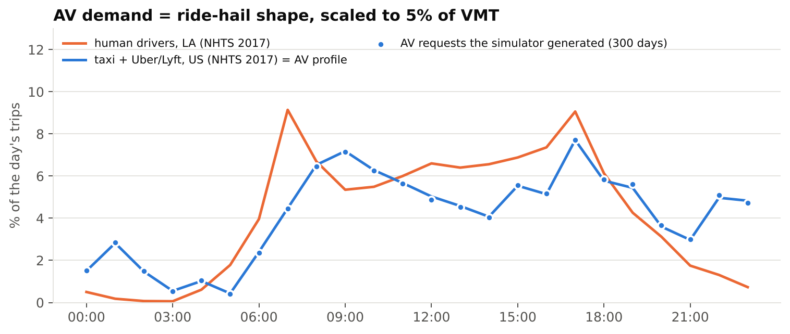

---

## 4. How wait time and congestion are calculated

**Congestion** (`travel_time()`, v3; BPR, Bureau of Public Roads 1964):

- When a car enters a road direction, `take_next_edge()` appends the minute to that direction's entry log.
- Flow q = entries in the last 60 minutes.
- Capacity = base (30 /h freeway, 12 /h arterial, model vehicles) x `cap_factor()`.
- Travel-time index = 1 + 0.15 x (q / capacity)^4, capped at 6; travel time = free-flow minutes x that index.

Congestion metrics (`metrics()`):

- **Human delay per trip** = mean over finished trips of (actual time - free-flow fastest time on the intact network),
  logged in `leg_done()`. It includes detours, time stuck on closed roads and waiting with no route.
- **Mean travel-time index** = mean of (actual / free-flow time) over every road entry of the day; **peak** = highest
  hourly mean.

**AV wait:**

- Requests wait in `pending`. Each minute `dispatch()` gives each request the nearest idle AV (congested drive time)
  that belongs to the same company, is not paused by a stall, and has range for pickup + trip + reaching its nearest
  usable depot + 10 mi reserve (50 mi in hand if no depot works). No assignment within 20 min = cancelled.
- **Served wait** = pickup minute - request minute (`_log_request()`).
- **Rider wait** (headline) = (sum of served waits + 20 x cancelled requests) / all requests, so a layout can't look
  better by cancelling riders. Unserved % and served-only wait are also reported, per company and for all riders.

**From days to annual numbers** (`report.py`):

- Rare rows are simulated given that they happen, then weighted:
  `annual = ordinary mean + sum_s rate_s x days_s x (scenario mean - ordinary mean) / 365` (`annualize()`).
- **Common random numbers:** a seed fixes demand and every hazard draw for every configuration, so differences
  between layouts are paired by seed (`paired()`); standard errors combine the ordinary and scenario differences
  with the same weights.
- **Runs:** placement, 7 layouts x (90 ordinary days + 25 days per scenario x 11 scenarios), plus the row-7-off and
  signals-off variants; fleets, 39 configurations x (15 ordinary + 6 days x 4 scenarios).

---

## 5. Results (2.0 mi/kWh; section 5.5 compares 3.5)

### 5.1 Which 5th depot? **Downtown LA or Hollywood on average; Downtown is the more resilient of the two**

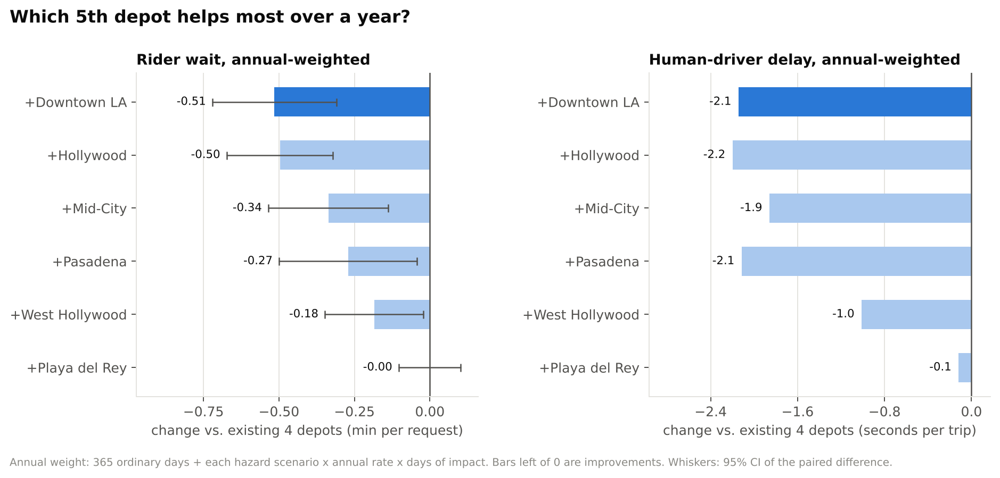

Annual-weighted rider wait with the existing four depots: **7.78 min**.

| Add a depot at | Change in rider wait (min) | 95% CI | Notes |
|---|---|---|---|
| **Downtown LA (6)** | **-0.51** (-6.6%) | ±0.21 | Best or tied for best in 7 of 12 scenarios; strongest grid position |
| **Hollywood (9)** | **-0.50** | ±0.18 | Tied with Downtown on average; depot dark in PSPS (WUI zone) |
| Mid-City (8) | -0.34 | ±0.20 | Weak grid position (bus 10) |
| Pasadena (10) | -0.27 | ±0.23 | Far end of the network and of the feeder; WUI |
| West Hollywood (3) | -0.19 | ±0.16 | Small gain |
| Playa del Rey (7) | -0.00 | ±0.10 | Next to two existing depots; adds nothing measurable |

- **Downtown vs Hollywood** (paired): -0.02 ± 0.08 min per year, a tie. On ordinary days they differ by 0.01 min.
  Under PSPS, Hollywood's depot is in the WUI zone and goes dark: Downtown is better by 0.15 ± 0.12 min with the
  row-7 trigger on and 0.51 min with it off (the fleet suspension hides the difference). Downtown vs Mid-City:
  -0.18 ± 0.09.
- **Grid side (fig 10).** Under every single-line outage, a 2-port Downtown depot keeps full power in 91% of cases.
  Hollywood keeps it in 66% and Pasadena in 47%. At 4 ports (0.43 MW), Downtown still gets 98% of its power with
  nothing failed; Hollywood gets 63%, Mid-City 54%, Pasadena 53%. Any plan to grow the 5th depot points to Downtown.
- **So:** on average Downtown and Hollywood are equivalent; Downtown is the pick because it keeps working in a PSPS
  and has the stronger grid connection.
- **Why the east side (interpretation, not measured directly).** All four existing depots are on the Westside, so
  AVs that end trips in Hollywood, Downtown or Pasadena drive back west to charge. A depot east of Culver City
  shortens those trips; human-driver delay also drops ~2 s per trip, consistent with less empty AV driving.

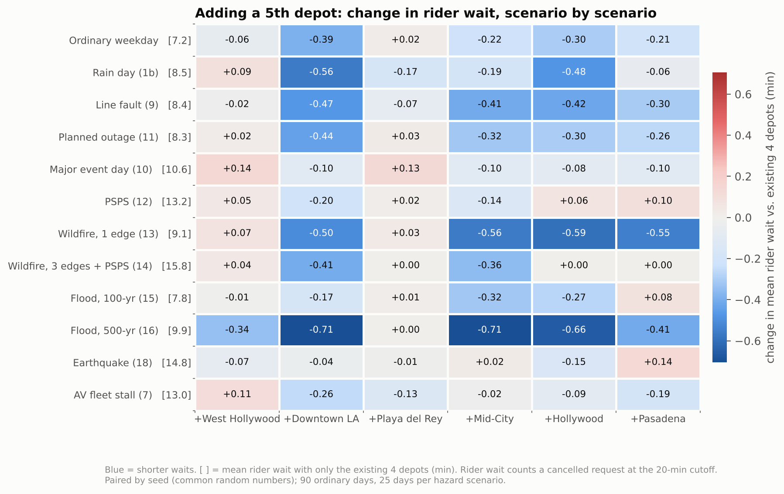

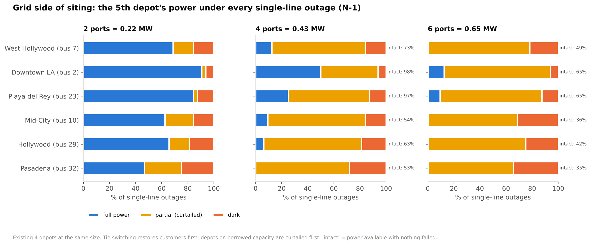

### 5.2 Grid outages now cause congestion

Human-driver delay per trip (min), existing 4 depots, same 25 days with and without the dark-signal coupling (row-7 off):

| Scenario | Signals ignored | Dark signals | Change |
|---|---|---|---|
| Major event day (10) | 4.83 | 6.40 | +32% |
| PSPS (12) | 4.86 | 6.76 | +39% |
| Earthquake (18) | 22.06 | 30.11 | +36% |
| Wildfire 3 roads + PSPS (14) | 12.21 | 14.37 | +18% |
| Line fault (9), planned (11), flood 100-yr (15) | 4.85-5.12 | 4.90-5.21 | +1-2% (switching restores power) |

The 500-yr flood cuts Playa del Rey off completely: trips to or from it never finish (about 3,190 of ~3,995 trips
complete), so its per-trip delay without signals (3.4 min) is lower than an ordinary day's. Read that bar in fig 5
with that in mind.

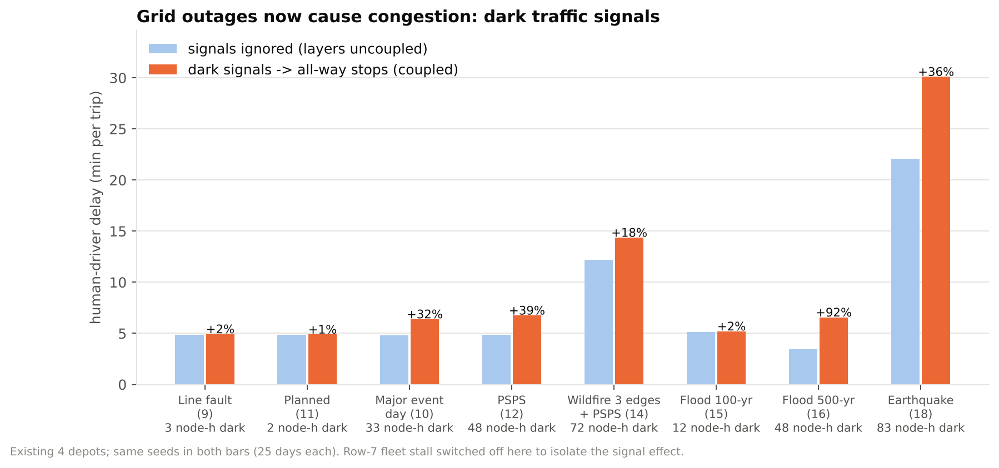

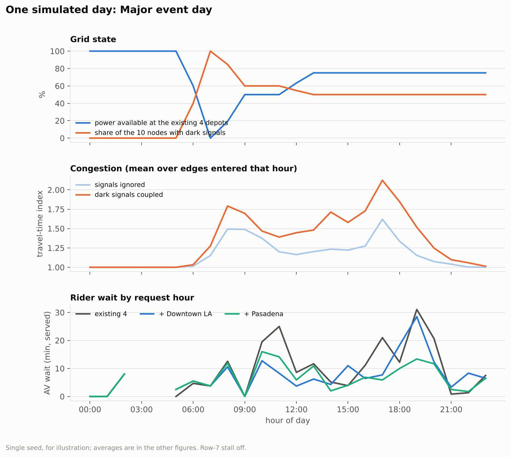

### 5.3 Row 7 dominates big outages

With the dark-signal stall trigger on, rider wait on a PSPS day is 13.4 min with the existing depots; with it off,
8.6 min. For a major event day the figures are 11.0 and 9.1. The suspension stops service at every depot equally,
so it shrinks the differences between sites (with it off, Mid-City edges ahead on a major event day; Downtown is
clearly first under PSPS; `results/placement_row7_sensitivity.csv`). How a fleet behaves at dark signals matters
more for big outages than where its fifth depot is.

### 5.4 A second fleet: universal depots win at every fleet size

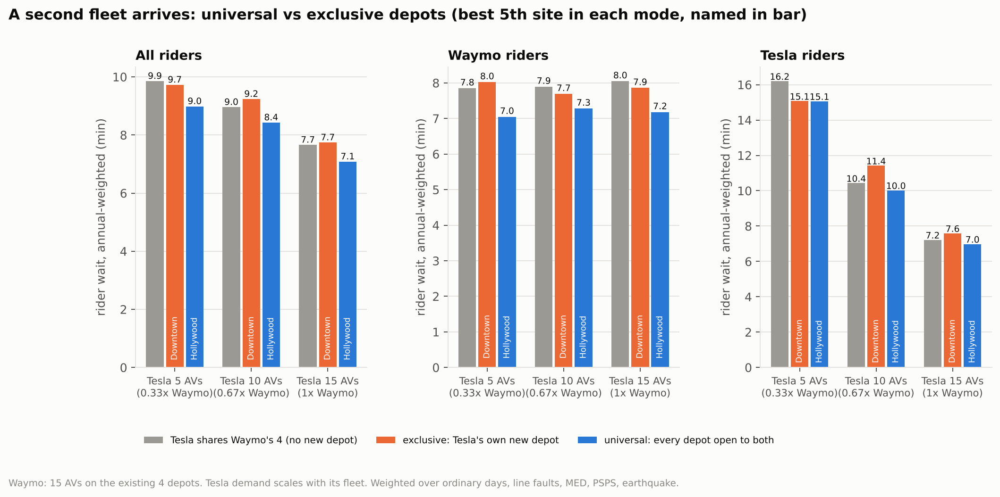

Waymo 15 AVs; Tesla 5, 10 or 15 AVs with proportional demand. Annual-weighted rider wait, all riders (min):

| Tesla fleet | Tesla shares Waymo's 4 | Best exclusive (Tesla-only new depot) | Best universal (all depots shared) |
|---|---|---|---|
| 5 AVs | 9.97 | 9.87 (Downtown) | **9.40** (Downtown; Hollywood 9.48) |
| 10 AVs | 9.36 | 9.53 (Hollywood) | **8.94** (Downtown; Hollywood 9.06) |
| 15 AVs | 7.95 | 8.21 (Downtown) | **7.35** (Downtown; Hollywood 7.39) |

- **Universal beats exclusive** at the same site by 0.47-0.98 min (paired, about 2-5 standard errors), for every
  fleet size at both Downtown and Hollywood.
- **One exclusive depot is no better than none.** Running Tesla's whole fleet out of a single private depot is about
  as good as, or worse than, letting Tesla charge at Waymo's four; every such difference is within noise (largest
  +0.42 ± 0.30 min). A single private depot puts every Tesla charge on one location: at 15 Tesla AVs the exclusive
  layouts queue 150-270 min/day of charging.
- **Waymo gains from sharing too.** With 15 Tesla AVs, Waymo's riders wait 8.20 min when Tesla crowds Waymo's
  four depots, 7.47-7.53 min when the 5th depot is universal at Downtown or Hollywood, and 8.22-8.56 min with an
  exclusive Tesla depot. Charging queues: 91 min/day at Waymo's four, 29-30 min/day with a universal 5th depot at
  Downtown or Hollywood.
- **Site.** Downtown and Hollywood are tied for the universal depot (Downtown ahead by 0.04-0.12 min, within noise).
  The worst exclusive site is Pasadena (9.48 min at 15 AVs, 270 min/day of queuing).
- **Small fleets wait regardless.** A 5-AV Tesla fleet gives its riders 15-17 min waits under every depot policy;
  at 15 AVs it is ~7 min with a good layout. For a small entrant, fleet size matters more than depot policy.

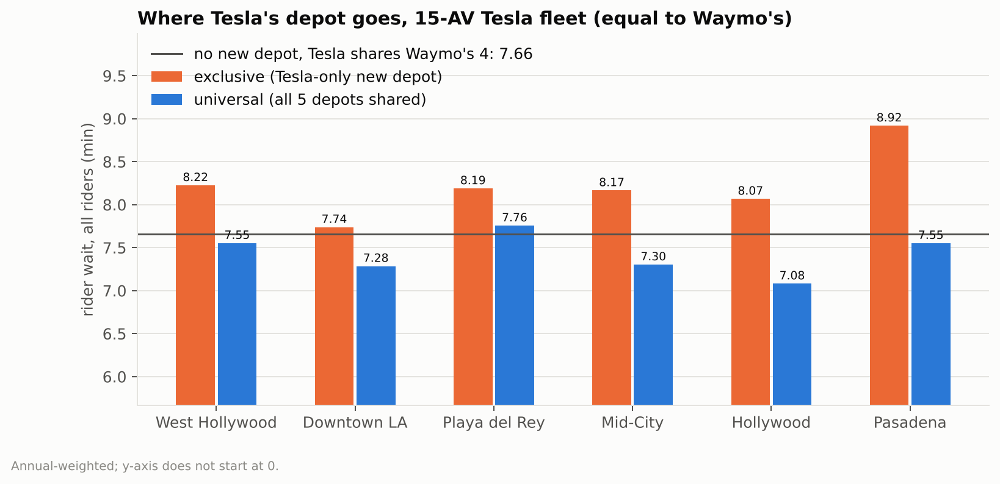

### 5.5 What changed from 3.5 to 2.0 mi/kWh

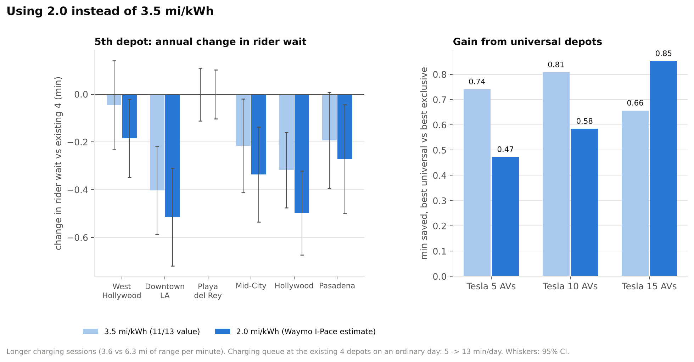

- Longer charging sessions raise the baseline rider wait from 7.39 to 7.78 min and the ordinary-day charging queue at
  the existing four depots from 5 to 13 min/day.
- Every candidate depot is worth more: Downtown -0.40 -> -0.51 min, Hollywood -0.32 -> -0.50, West Hollywood
  -0.05 -> -0.19. Hollywood catches up with Downtown on the annual average.
- Universal still beats exclusive at every fleet size, and exclusive Tesla depots get much longer queues.

Full tables: `results/summary.md`, `results/placement_annual.csv`, `results/placement_by_scenario.csv`,
`results/fleets_summary.csv`, `results/energy_compare.csv`.

---

## Modeling limits (state these with any result)

- **One feeder for the whole corridor.** Real depots 20 miles apart sit on different feeders and substations. The
  33-bus feeder is a placeholder; the node <-> bus table encodes relative grid strength and hazard zone only.
- **Instant switching.** Tie switching restores customers in the same minute; real manual switching takes tens of
  minutes, so short dark periods are understated.
- **Model scale.** 15 Waymo AVs, 2 ports per depot, uniform origins/destinations. The fleet was sized for no unserved
  requests on an ordinary day, so charging capacity rarely binds; that is why ordinary-day differences are small
  and grid-driven differences show up mainly in hazards.
- **Exclusive = one Tesla depot.** A real entrant would build several; the exclusive case is the "one new depot"
  constraint from the task.
- **Placeholders that drive results:** PSPS q = 0.10, the dark-signal factors, P(stall | dark signals) = 0.5,
  WUI/flood edge tags, the node <-> bus table. Change them in `config.py` / `scenarios.py`.
- **Multi-day events.** Earthquake and wildfire closures last weeks; only the first day is simulated, and the
  rest enters only through the `days` weight.
- **Cancellation counted at 20 min.** A served rider can wait longer than 20 min if the pickup drive is slow, so in
  heavily damaged scenarios (earthquake) a cancellation can score better than a very late pickup. Unserved % is
  reported alongside for that reason.
- **Midnight cutoff.** Trips unfinished at midnight and requests still open are left out of the averages. The 500-yr
  flood cuts Playa del Rey off, so only ~80% of trips finish and its per-trip delay is understated.
- **Cars already on a road** react to capacity changes (2.1) but not to flow changes after they entered.

## Sources

Outside sources used for parameters or checks (Failure Mode Table sources are on its *Sources* sheet):

- Dark signal = all-way stop: City of Toronto, *Signal power outages*; Oregon DOT, *Winter power failure*;
  Jefferson County CO 311.
- All-way-stop capacity 400-1,400 veh/h (up to ~1,900): Al-Kaisy & Doruk (2023), *Capacity at All-Way Stop Control
  Intersections: Case Study*, TRR 2677(8):148-157.
- Signal saturation headway 1.9 s (1,900 veh/h of green): HCM, via NCHRP Report (nap.edu/read/6339).
- Signal battery backup (~half of signals, up to 6 h): Austin Monitor, 8 Feb 2023.
- Dec 2025 SF outage, Waymo stalls and suspension; Jan 2026 fleet update: AP (via Star Tribune), Axios, Wards Auto.
- LA ride-hail peak Saturday 9 p.m.: TCRP Research Report 195 (2018), nap.edu/24996.
- Ride-hail ~12x taxi trips in SF: SFCTA, *TNCs Today* (2017).
- No public data on a driverless Tesla fleet in LA; fleet size is a sweep.
- AV energy use (section 2.6), all secondary reporting:
  - I-Pace 90 kWh: KOMO News on the 2018 Waymo-Jaguar announcement,
    https://komonews.com/news/auto-matters/waymo-jaguar-land-rover-create-first-electric-self-driving-vehicle
  - Ojai 93 kWh (EPA documents) and motor (NHTSA documents): Car and Driver via Yahoo,
    https://www.yahoo.com/news/articles/could-autonomous-taxi-ride-waymo-211600068.html
  - Earlier 76 kWh reports: InsideEVs, https://insideevs.com/news/783573/waymo-zeekr-ojai-van/
  - Waymo I-Pace 50-60 kWh/100 mi estimates:
    https://eletric-vehicles.com/waymo/waymos-retrofitted-robotaxis-guzzle-several-times-tesla-cybercabs-energy/
